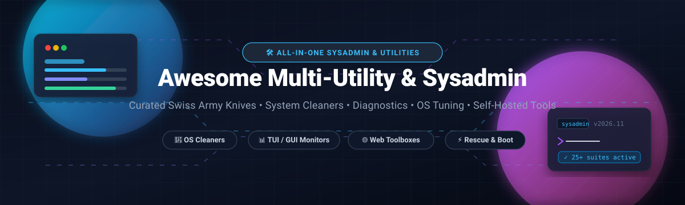

  

# 🛠️ Awesome Multi-Utility Tooling & SysAdmin Utilities

  
  
  
  
  

---

## 🧭 Executive Summary & SEO Overview

Welcome to the definitive directory for **Multi-Utility Tooling & SysAdmin Utilities**! Whether you are an enterprise system administrator, DevOps/SRE engineer, IT helpdesk specialist, homelab enthusiast, or power user, this curated guide benchmarks the finest **cloud-managed SaaS suites** and **battle-tested open-source software (OSS)**.

From all-in-one system cleaners, registry purgers, startup accelerators, and cross-platform TUI/GUI telemetry monitors to self-hosted browser utility Swiss Army knives, live data rescue engines, and bulk software provisioning systems—this collection ensures peak computer performance, privacy sanitization, and automated fleet administration.

### 📑 Table of Contents
- [📊 Sector Overview & Market Dynamics](#-sector-overview--market-dynamics)
- [🏢 SaaS & Hosted Commercial Platforms](#-saas--hosted-commercial-platforms)
- [💻 Open-Source GitHub Projects](#-open-source-github-projects)
- [🤝 How to Contribute](#-how-to-contribute)
- [💖 Support & Sponsorship](#-support--sponsorship)
- [📈 Star History](#-star-history)
- [⚠️ Disclaimer](#-disclaimer)

---

## 📊 Sector Overview & Market Dynamics

The global market for PC optimization, system utility software, and endpoint management was valued at approximately **$3.5 billion in 2024–2025** and is projected to expand beyond **$6.2 billion by 2032**, demonstrating a resilient compound annual growth rate (**CAGR of ~7.8%–9.9%**). When combined with broader enterprise system infrastructure and monitoring utilities, the market scales well over **$175 billion**.

The sector exhibits **moderate fragmentation with high brand concentration at the top**:
- **Enterprise & Core OS Tier:** Dominated by mega-cap infrastructure leaders (e.g., Microsoft Sysinternals) and cybersecurity conglomerates (e.g., Gen Digital owning CCleaner and AVG TuneUp), creating concentrated moats around endpoint telemetry, digital certificates, and automated endpoint patching.
- **Consumer & SMB Mid-Market:** A fiercely contested, moderately fragmented competitive landscape where independent software vendors (iolo RealDefense, MacPaw, Ashampoo, Glarysoft, WiseCleaner) compete on proprietary cleaning algorithms, one-click speed optimizations, and unified device privacy shields.
- **Open-Source Counterbalance:** Rapid emergence of decentralized, privacy-respecting community utilities (PowerToys, Ventoy, winutil, btop++, CyberChef, IT-Tools, CzKawka, Pearcleaner) serving as zero-cost, telemetry-free counterbalances to commercial subscription utilities.

---

## 🏢 SaaS & Hosted Commercial Platforms

The following SaaS and commercial platforms deliver endpoint diagnostics, cloud-coordinated software deployment, automated registry & disk sanitization, and background performance acceleration.

*Entries are ranked in descending order by parent company scale (revenue / market capitalization).*

| 🏷️ Product / Platform | 🏢 Parent Company / Scale (Revenue / Valuation) | 💵 Specific Pricing (Starting Paid Tier) | 🎁 Specific Free Tier / Trial Limits | 🔍 Core Capabilities & Highlights |
| :--- | :--- | :--- | :--- | :--- |
| **[Microsoft Sysinternals](https://learn.microsoft.com/en-us/sysinternals/)** | Microsoft (Valuation: ~$3.1T+ / Rev: ~$245B+) | **$0.00** (100% Free freeware suite by Microsoft) | **Free Forever**: Completely unrestricted full access to all 70+ utilities; runnable live via Sysinternals Live | Definitive enterprise troubleshooting suite (Process Explorer, ProcMon, Autoruns, TCPView, Sysmon) for live OS diagnostics and kernel inspection. |
| **[CCleaner Cloud](https://www.ccleaner.com/business/ccleaner-cloud)** | Gen Digital (Market Cap: ~$17.5B / Rev: ~$5.2B) | **$29.95 / endpoint / year** (CCleaner Cloud Business) | **14-day free trial**: Full access for up to 10 endpoints; no credit card required | Centralized cloud management console for remote PC health inspection, silent junk cleanup, software inventory audits, and defragmentation. |
| **[AVG TuneUp](https://www.avg.com/tuneup)** | Gen Digital (Market Cap: ~$17.5B / Rev: ~$5.2B) | **$29.99 / year** for 1 PC (renews at $69.99/yr); Multi-device (10 PCs/Macs) at $34.99/yr | **7-day free trial**: Unrestricted access to all tools; Free edition only allows scanning without repairing issues | Cloud-connected system performance booster featuring Sleep Mode background process hibernation, registry defragmentation, and disk hygiene. |
| **[CleanMyMac / CleanMyPC](https://cleanmymac.com/)** | MacPaw (Estimated Revenue: ~$50M - $100M+) | **$39.95 / year** for 1 Mac (or one-time lifetime license at $89.95) | **7-day free trial**: Full access to all cleaning modules; rolling into subscription unless cancelled | Premium macOS/Windows system hygiene suite bundling malware scans, disk space visualization, orphaned cache purging, and RAM optimization. |
| **[System Mechanic](https://www.iolo.com/products/system-mechanic/)** | RealDefense / iolo (Estimated Revenue: ~$60M - $70M) | **$39.95 / year** (Base Pro regularly discounted to $24.95/yr for up to 10 PCs) | **Free Forever Basic Plan**: Manual basic junk cleanup and boot items inspection; live Smart ActiveCare & memory boosting locked | Automated Windows tuning suite combining automated disk cleanup, startup acceleration, live CPU/RAM load balancing, and registry repair. |
| **[Ashampoo WinOptimizer](https://www.ashampoo.com/products/winoptimizer)** | Ashampoo GmbH (Estimated Revenue: ~$11M) | **$14.00 - $29.99** one-time perpetual license (covers up to 10 household PCs) | **Free Forever Basic Plan** (*WinOptimizer FREE*): Routine manual junk cleanup & basic registry defrag; 20+ deep tweaks and auto-cleaners locked | Comprehensive modular PC maintenance toolkit offering 30+ modules including privacy telemetry toggles, file shredders, and SSD benchmark analyzers. |
| **[Glary Utilities Pro](https://www.glarysoft.com/glary-utilities-pro/)** | Glarysoft Ltd (Estimated Revenue: ~$5.1M) | **$19.97 / year** for up to 3 PCs (50% promotional rate; standard list $39.95/yr) | **Free Forever Basic Plan**: Unscheduled manual 1-click cleanups for personal use; automated scheduling and auto-updates locked | All-in-one Windows maintenance utility offering deep disk cleaners, driver backup, duplicate file pickers, memory management, and context menu editors. |
| **[Wise Care 365 Pro](https://www.wisecleaner.com/wise-care-365.html)** | WiseCleaner (Estimated Revenue: ~$440K) | **$22.46 / year** for 1 PC (or $37.46 lifetime license for 3 PCs) | **Free Forever Basic Plan**: Standard junk scan and hardware viewer; deep cleaning, background auto-clean, and silent updates locked | Streamlined Windows optimization suite combining privacy trace sanitizers, registry defragmentation, startup manager, and floating telemetry widget. |
| **[Ninite Pro](https://ninite.com/pro)** | Secure by Design Inc (Estimated Revenue: ~$200K) | **$20.00 / month** (covers up to 20 machines; $1.00/machine/month scaling down to $0.25/machine) | **14-day free trial**: Unrestricted cloud web dashboard access for managing full software deployment; no credit card required | Lightweight silent bulk software installer and remote patch deployment agent built specifically for sysadmins, MSPs, and IT service desks. |

---

## 💻 Open-Source GitHub Projects

Explore the most powerful community-driven, free, and open-source system administration software, performance monitors, disk analyzers, and privacy tools.

*Repositories are sorted in descending order by GitHub stargazers count.*

| 📦 Repository & Project Name | ⭐ GitHub Stars | 🎯 Category / Primary Focus | 🛠️ Technology Stack | 💡 Core Purpose & Description |
| :--- | :--- | :--- | :--- | :--- |
| **[microsoft/PowerToys](https://github.com/microsoft/PowerToys)** |  | Windows Power User Toolkit | C++, C#, XAML | Premier set of system utilities for Windows power users including FancyZones window tiling, PowerToys Run, OCR Text Extractor, and Awake. |
| **[ventoy/Ventoy](https://github.com/ventoy/Ventoy)** |  | Bootable USB & OS Deployment | C, Shell | Revolutionary bootable USB solution allowing users to boot directly from ISO/WIM/IMG/VHD(x)/EFI files without reformatting the flash drive. |
| **[ChrisTitusTech/winutil](https://github.com/ChrisTitusTech/winutil)** |  | Windows Automation & Debloat | PowerShell | Comprehensive Windows sysadmin utility for automated Winget app installs, telemetry debloating, Windows Update policy enforcement, and OS tweaks. |
| **[Raphire/Win11Debloat](https://github.com/Raphire/Win11Debloat)** |  | Windows Debloating & Hardening | PowerShell | Lightweight, transparent PowerShell script to remove bloatware, disable Bing/Cortana tracking, strip telemetry, and restore classic context menus. |
| **[CorentinTh/it-tools](https://github.com/CorentinTh/it-tools)** |  | Web Sysadmin / Dev Utilities | TypeScript, Vue | Incredible collection of handy online utilities for developers and sysadmins (token generators, hashers, CIDR calculators, Docker self-hosted). |
| **[pbatard/rufus](https://github.com/pbatard/rufus)** |  | Bootable Media & OS Imaging | C | Fast, reliable utility to format and create bootable USB drives, complete with automated Windows 11 TPM, SecureBoot, and Microsoft account bypasses. |
| **[gchq/CyberChef](https://github.com/gchq/CyberChef)** |  | Data Transformation & Crypto | JavaScript | The "Cyber Swiss Army Knife" — client-side web application for encryption, decoding, hex dumping, regex parsing, compression, and data forensics. |
| **[aristocratos/btop](https://github.com/aristocratos/btop)** |  | TUI Terminal Resource Monitor | C++ | Resource monitor that shows usage and stats for processor, memory, disks, network, and processes with an exquisite responsive game-like TUI. |
| **[qarmin/czkawka](https://github.com/qarmin/czkawka)** |  | Disk Cleaning & Deduplication | Rust, GTK | Multi-functional, multi-threaded open-source tool to find duplicate files, empty directories, similar images/videos, broken symlinks, and bad music files. |
| **[nicolargo/glances](https://github.com/nicolargo/glances)** |  | System Monitoring & REST API | Python | Cross-platform curses-based system monitoring tool with built-in Web GUI, Prometheus exporter, and RESTful API client. |
| **[gethomepage/homepage](https://github.com/gethomepage/homepage)** |  | Homelab Dashboard & Status | JavaScript, React | Highly customizable, secure, and fast application dashboard with built-in integrations for 100+ sysadmin services and Docker containers. |
| **[Devolutions/UniGetUI](https://github.com/Devolutions/UniGetUI)** |  | Package Manager GUI | C#, WinUI 3 | Unified intuitive graphical interface for managing CLI package managers (`Winget`, `Scoop`, `Chocolatey`, `Pip`, `Npm`, `.NET Tool`). |
| **[BCUninstaller/Bulk-Crap-Uninstaller](https://github.com/BCUninstaller/Bulk-Crap-Uninstaller)** |  | Bulk Uninstaller & Registry Cleaner | C# | Bulk program uninstaller capable of detecting portable apps, silently removing leftover files/registry keys, and cleaning stubborn bloatware. |
| **[winsiderss/systeminformer](https://github.com/winsiderss/systeminformer)** |  | Process & Kernel Diagnostics | C | Free, powerful multi-purpose diagnostic tool (formerly Process Hacker) for monitoring resources, debugging software, and inspecting handles/tokens. |
| **[cockpit-project/cockpit](https://github.com/cockpit-project/cockpit)** |  | Web-Based Server Admin GUI | C, JavaScript | Interactive web console for Linux servers enabling easy storage management, service control, firewall tweaking, user administration, and terminal access. |
| **[alienator88/Pearcleaner](https://github.com/alienator88/Pearcleaner)** |  | macOS App Uninstaller & Cleaner | Swift, SwiftUI | Free, open-source macOS app uninstaller inspired by AppCleaner and CleanMyMac; locates orphaned library caches, logs, and application leftovers. |
| **[ClementTsang/bottom](https://github.com/ClementTsang/bottom)** |  | Cross-Platform Terminal Monitor | Rust | Modern, customizable graphical process and system telemetry monitor for terminal power users, supporting customizable widgets and disk/temp metrics. |
| **[bootandy/dust](https://github.com/bootandy/dust)** |  | Disk Usage Visualizer (du in Rust) | Rust | Instant terminal disk usage analyzer that draws intuitive ASCII tree graphs showing exactly what directories and files consume storage. |
| **[iib0011/omni-tools](https://github.com/iib0011/omni-tools)** |  | Self-Hosted Web Toolbox | TypeScript, Vue | Comprehensive self-hosted web application delivering 80+ fast client-side utilities for PDFs, images, code formatters, and audio conversion. |
| **[LibreHardwareMonitor/LibreHardwareMonitor](https://github.com/LibreHardwareMonitor/LibreHardwareMonitor)** |  | Hardware Sensor Telemetry | C# | Open-source low-level telemetry monitor tracking CPU/GPU temperatures, fan speeds, clock frequencies, power draw, and motherboard sensors. |
| **[oguzhaninan/Stacer](https://github.com/oguzhaninan/Stacer)** |  | Linux System Optimizer & Monitor | C++, Qt | Elegant dashboard-driven Linux system optimizer featuring APT cache cleaning, daemon startup toggles, process managers, and root uninstallation. |
| **[bleachbit/bleachbit](https://github.com/bleachbit/bleachbit)** |  | Disk Cleaner & Privacy Manager | Python, GTK | The industry-standard open-source cleaner for Windows and Linux; wipes cache, clears browser history, deletes temp files, and shreds confidential data. |
| **[dundee/gdu](https://github.com/dundee/gdu)** |  | Fast Console Disk Usage Analyzer | Go | Blazing-fast disk usage analyzer with console interface written in Go, specifically optimized for massive SSD arrays and remote cloud servers. |
| **[undergroundwires/privacy.sexy](https://github.com/undergroundwires/privacy.sexy)** |  | OS Privacy & Security Enforcer | TypeScript, Shell | Open-source privacy tool enforcing hundreds of granular privacy tweaks across Windows, macOS, and Linux to stop OS tracking and disable spyware. |
| **[homarr-labs/homarr](https://github.com/homarr-labs/homarr)** |  | Sysadmin Dashboard & Homelab | TypeScript, Next.js | Modern, sleek homelab dashboard putting all your server services, Docker containers, and internal web utilities at your fingertips. |
| **[cgsecurity/testdisk](https://github.com/cgsecurity/testdisk)** |  | Partition Recovery & File Carving | C | Legendary data recovery utilities (TestDisk & PhotoRec) engineered to repair lost disk partitions, fix boot sectors, and carve lost files. |

---

## 🤝 How to Contribute

Contributions from the sysadmin, DevOps, and power user community are warmly encouraged!

1. 🍴 **Fork the Repository** to your GitHub account.
2. 🌿 **Create a New Branch** (`git checkout -b feature/awesome-utility`).
3. 📝 **Add or Enhance Entries** in `README.md`:
   - Keep descriptions factual, unbiased, and technically accurate.
   - For SaaS tools: include verified pricing tiers, specific free trial/tier limits, and parent company valuation/revenue data.
   - For Open-Source tools: include the official GitHub repository link, star badge (`style=social&color=white`), tech stack, and primary category.
4. 🚀 **Submit a Pull Request** with a concise description of why the tool deserves inclusion.

---

## 💖 Support & Sponsorship

If this curated sysadmin toolbox saved you troubleshooting hours, reclaimed gigabytes of SSD space, or streamlined your IT workflow, please consider showing your support:

- ⭐ **Star this repository** to help other engineers discover it.
- 🍴 **Fork and share** it with your colleagues, DevOps teams, and homelab groups.
- ☕ **Buy us a coffee** or sponsor ongoing maintenance via the [GitHub Sponsor Dashboard](https://github.com/sponsors/ishandutta2007).

Thank you for powering open-source software and community knowledge!

---

## 📈 Star History

#

---

## ⚠️ Disclaimer

- This list is independently curated by the open-source community for educational and administrative efficiency purposes.
- Deep system cleaners, registry scrubbers, and debloat scripts (`BleachBit`, `winutil`, `TestDisk`) execute low-level operating system modifications. Always configure system restore points or reliable disk backups before executing destructive disk or registry changes.
